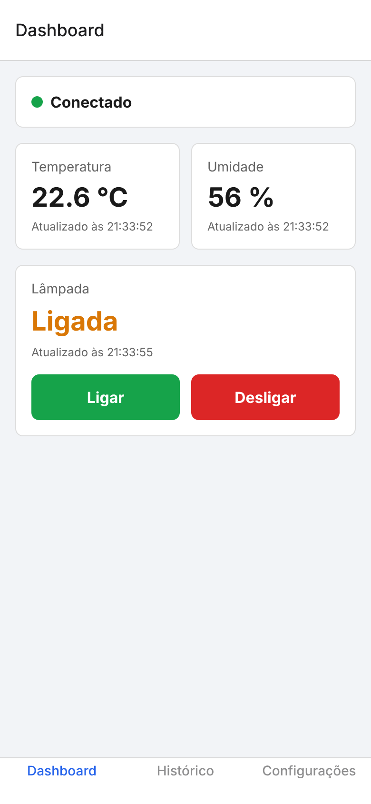
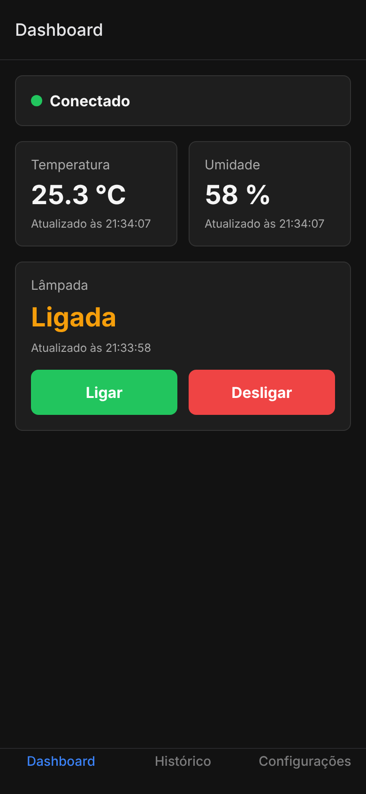
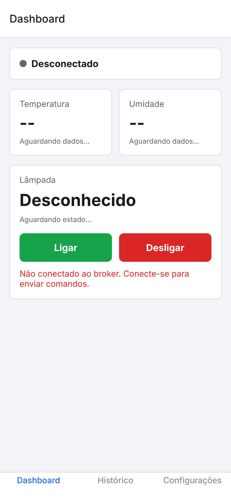
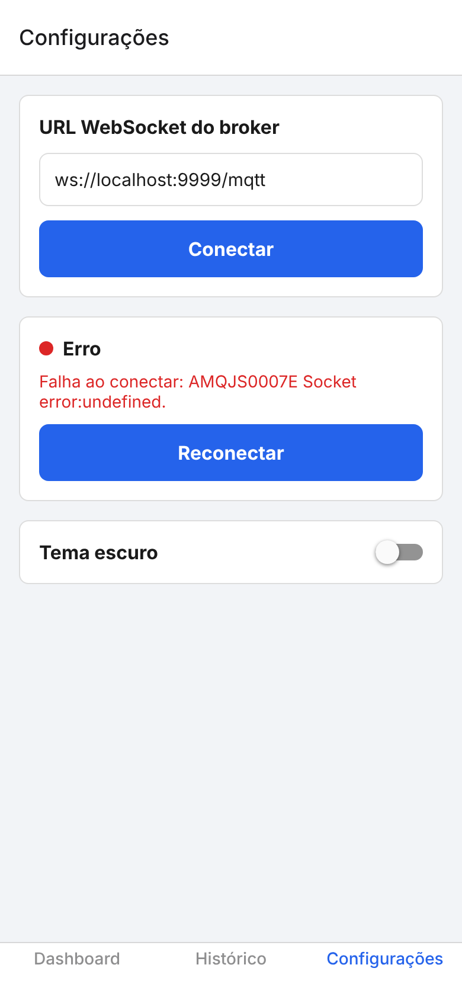
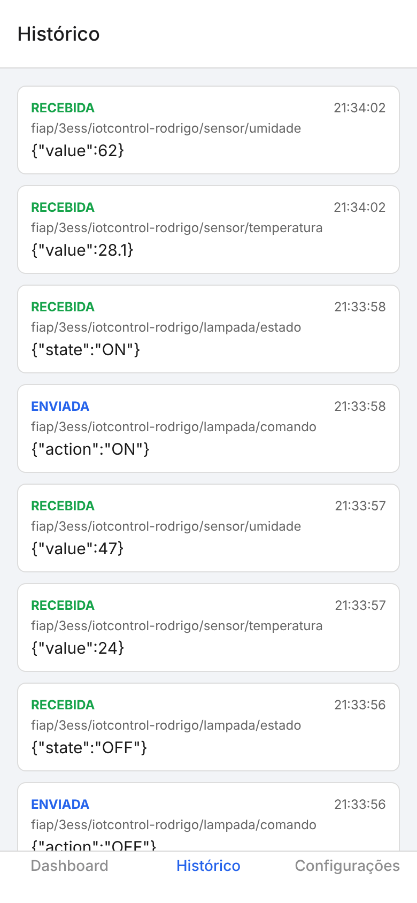
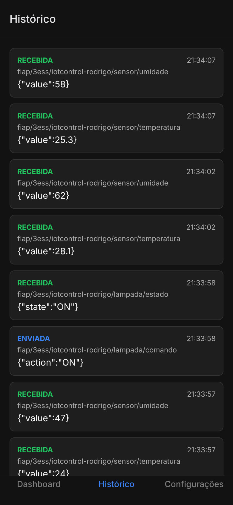
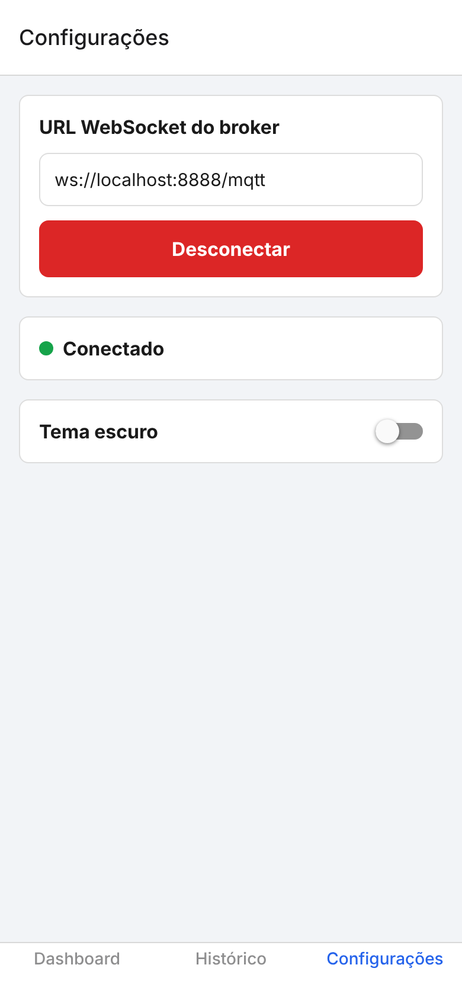
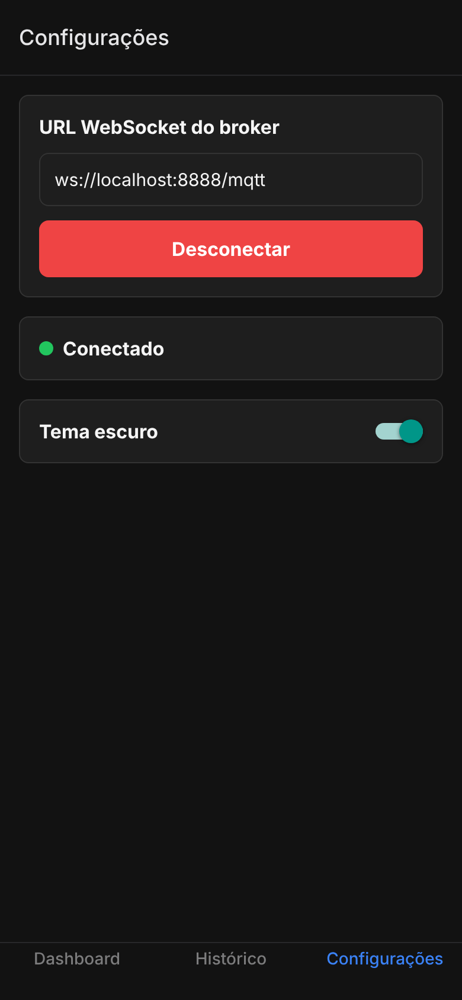

# IoT Control — MQTT em React Native

Checkpoint 3 — Mobile Development & IoT (FIAP — 3ESS)

## Integrante

| Nome completo | RM |
|---|---|
| Rodrigo Leme | RM550266 |

## Descrição e objetivo

O **IoT Control** é um aplicativo mobile que funciona como painel de monitoramento e controle de um ambiente inteligente simulado. Ele se comunica com um dispositivo IoT por meio do protocolo **MQTT** (modelo publish/subscribe), usando um broker acessível por **WebSocket**.

O app permite:

- acompanhar em tempo real a **temperatura** e a **umidade** enviadas pelo dispositivo;
- **ligar e desligar uma lâmpada virtual**, exibindo o estado confirmado pelo dispositivo;
- ver o **histórico das 10 últimas mensagens** enviadas e recebidas;
- configurar o **endereço do broker** e o **tema Light/Dark**, salvos no aparelho.

Não é necessário hardware: o script `simulator/simulador.js` faz o papel do dispositivo.

## Tecnologias e versões

| Tecnologia | Versão |
|---|---|
| Expo SDK | 58 |
| React Native | 0.88.0 |
| React | 19.3.0 |
| TypeScript | 6.0 |
| React Navigation (Bottom Tabs) | 7.x |
| AsyncStorage (`@react-native-async-storage/async-storage`) | 2.2.0 |
| Cliente MQTT do app (`paho-mqtt`) | 1.1.0 |
| Cliente MQTT do simulador (`mqtt`) | 5.x |
| Node.js (para rodar o simulador) | 18 ou superior |

## Instalação e execução

Pré-requisitos: Node.js instalado e o app **Expo Go** no celular (ou emulador Android/iOS).

```bash
# 1. Instalar as dependências
npm install

# 2. Iniciar o aplicativo
npx expo start
```

Depois, leia o QR Code com o Expo Go (Android) ou com a câmera (iOS). Também é possível pressionar `a` (Android), `i` (iOS) ou `w` (Web) no terminal.

## Broker MQTT

Foi utilizado o broker público da HiveMQ, acessado por **WebSocket seguro (WSS)**:

```
wss://broker.hivemq.com:8884/mqtt
```

| Item | Valor |
|---|---|
| Host | `broker.hivemq.com` |
| Porta WebSocket (WSS) | `8884` |
| Caminho | `/mqtt` |
| Autenticação | não necessária |

> A porta `1883` é MQTT via TCP e **não** funciona no aplicativo. O app usa somente a porta WebSocket `8884`.

Essa URL já vem preenchida na tela **Configurações** e pode ser alterada. Nenhuma senha ou credencial é usada no projeto.

## Tópicos MQTT

Identificador exclusivo do projeto: `fiap/3ess/iotcontrol-rodrigo`

| Tópico | Direção no aplicativo | Payload |
|---|---|---|
| `fiap/3ess/iotcontrol-rodrigo/sensor/temperatura` | Subscribe | `{"value":24.5}` |
| `fiap/3ess/iotcontrol-rodrigo/sensor/umidade` | Subscribe | `{"value":58}` |
| `fiap/3ess/iotcontrol-rodrigo/lampada/comando` | Publish | `{"action":"ON"}` ou `{"action":"OFF"}` |
| `fiap/3ess/iotcontrol-rodrigo/lampada/estado` | Subscribe | `{"state":"ON"}` ou `{"state":"OFF"}` |

O simulador faz o caminho inverso: publica temperatura, umidade e estado, e se inscreve no tópico de comando.

## Simulador

O simulador fica em `simulator/simulador.js`. Ele:

1. conecta no mesmo broker (`wss://broker.hivemq.com:8884/mqtt`);
2. publica temperatura e umidade aleatórias **a cada 5 segundos**;
3. se inscreve no tópico de comando da lâmpada;
4. ao receber `{"action":"ON"}` ou `{"action":"OFF"}`, publica o novo estado no tópico `lampada/estado`.

Para executar (em outro terminal, com as dependências já instaladas):

```bash
npm run simulador
```

### Ciclo completo de teste

1. Abra o app, vá em **Configurações** e toque em **Conectar**.
2. Rode `npm run simulador`.
3. No **Dashboard**, a temperatura e a umidade são atualizadas sozinhas a cada 5 segundos.
4. Toque em **Ligar**: o simulador recebe o comando e publica o estado; o app mostra **Ligada**.
5. Toque em **Desligar**: o app mostra **Desligada**.
6. Na aba **Histórico**, aparecem as mensagens enviadas e recebidas.

### Alternativa sem o script

Também é possível simular o dispositivo pelo cliente web da HiveMQ (https://www.hivemq.com/demos/websocket-client/):

1. Conecte com host `broker.hivemq.com`, porta `8884` e SSL marcado.
2. Publique `{"value":24.5}` em `fiap/3ess/iotcontrol-rodrigo/sensor/temperatura`.
3. Publique `{"value":58}` em `fiap/3ess/iotcontrol-rodrigo/sensor/umidade`.
4. Inscreva-se em `fiap/3ess/iotcontrol-rodrigo/lampada/comando` para ver os comandos do app.
5. Ao receber um comando, publique `{"state":"ON"}` ou `{"state":"OFF"}` em `fiap/3ess/iotcontrol-rodrigo/lampada/estado`.

## Telas e funcionalidades

> Os prints foram feitos com o app rodando na versão Web (tamanho de celular), conectado a um broker MQTT local (`ws://localhost:8888/mqtt`) e com o simulador do repositório publicando os dados. O funcionamento é o mesmo com o broker da HiveMQ.

### Dashboard

- Status da conexão: **Conectando**, **Conectado**, **Desconectado** ou **Erro**.
- Em caso de erro, mostra a mensagem e o botão **Reconectar**.
- Cards de temperatura e umidade com o último valor e o horário da atualização.
- Estado da lâmpada (**Ligada**, **Desligada** ou **Desconhecido**) com horário.
- Botões **Ligar** e **Desligar**. Se o app estiver desconectado, aparece um aviso e nada é publicado.
- O estado da lâmpada só muda quando chega a mensagem do tópico `lampada/estado`, e não ao tocar no botão.

| Light | Dark |
|---|---|
|  |  |

Sem conexão e com erro de conexão:

| Aviso ao publicar desconectado | Erro de conexão |
|---|---|
|  |  |

### Histórico

- Lista as **10 mensagens mais recentes**, com direção (enviada/recebida), horário, tópico e payload.
- Atualiza automaticamente enquanto o app estiver aberto.

| Light | Dark |
|---|---|
|  |  |

### Configurações

- Campo da URL WebSocket do broker.
- Botão **Conectar** / **Desconectar**.
- Alternância entre tema **Light** e **Dark**.
- A URL (salva ao conectar) e o tema (salvo ao alternar) ficam no **AsyncStorage** e são carregados ao reabrir o app.

| Light | Dark |
|---|---|
|  |  |

## Organização do código

```
App.tsx                       # Estados do app, navegação e ligação entre telas e serviços
simulator/
  simulador.js                # Simulador do dispositivo IoT
screenshots/                  # Prints das telas
src/
  components/
    AppButton.tsx             # Botão reutilizável
    ConnectionStatus.tsx      # Status da conexão + botão Reconectar
    MessageItem.tsx           # Item do histórico
    SensorCard.tsx            # Card de sensor
  screens/
    DashboardScreen.tsx
    HistoryScreen.tsx
    SettingsScreen.tsx
  services/
    mqttService.ts            # Conexão, inscrição, publicação e validação das mensagens MQTT
    storageService.ts         # Leitura e gravação no AsyncStorage
  types/
    mqtt.ts                   # Tipos do projeto
  themes/
    colors.ts                 # Cores dos temas Light e Dark
```

Pontos técnicos:

- A comunicação MQTT fica separada da interface, em `mqttService.ts`.
- Mensagens recebidas são validadas (`JSON` válido, `value` numérico, `state` igual a `ON` ou `OFF`). Mensagens inválidas aparecem no histórico, mas não alteram os cards.
- Ao desconectar, o app cancela as inscrições e remove os listeners do cliente MQTT, evitando eventos duplicados. O mesmo acontece ao fechar o app (cleanup do `useEffect`).

## Limitações e observações

- O broker `broker.hivemq.com` é público: qualquer pessoa pode publicar nos mesmos tópicos. Por isso foi usado um identificador exclusivo (`iotcontrol-rodrigo`).
- O celular (e o computador com o simulador) precisa ter acesso à internet.
- O app não guarda leituras: ao reabrir, os valores começam vazios até chegar uma nova mensagem. O estado da lâmpada aparece como **Desconhecido** até o primeiro comando confirmado.
- O histórico fica apenas em memória, enquanto o app estiver aberto.
- O app funciona em Android, iOS e Web (a biblioteca `paho-mqtt` usa WebSocket, disponível nas três plataformas).
